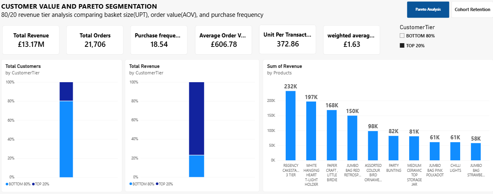
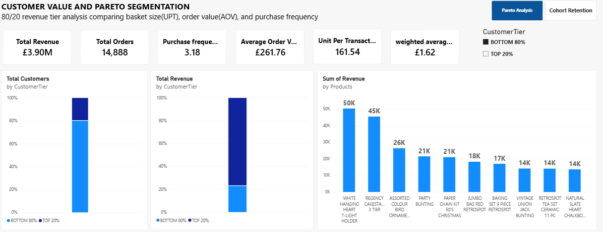

## PROJECT NAME: PARETO AND COHORT RETENTION REPORT 
**DATA SOURCE: KAGGLE(ONLINE RETAIL DATASET)**

## EXECUTIVE SUMMARY
Management tracked overall company sales across its online retail catalog but lacked visibility into which customers drove that revenue,
their purchase behavior and where churn risk was highest. A combined pareto and cohort revenue retention analysis revealed that the top 20% of
registered buyers generate 77.17% of total revenue, driven by bulk ordering(372.86) and high repeat frequency rather than higher unit prices.
Also, cohort tracking exposed a sharp behavioral divide, Top 20% buyers return after their first purchase and restock every other month then peak at Q4
while bottom 80% drop 14.37% revenue retention on Average after their first order and behave largely as occasional seasonal buyers.

## METHODOLOGY AND DATA NOTES
**Data Cleaning & Segmentation ('MySQL 8.0')**

**.Guest Checkout Isolation:** Unregistered Customers 'Guests' transactions were isolated from customer tier so anonymous checkouts would not artificially
   skew Pareto percentiles or cohort tracking,while remaining included in overall company revenue totals.

**.Pareto 80/20 Classification:** Used Common Table Expressions (CTEs) and 'NTILE(5)' window functions on
   cumulative customer spend to segment registered buyers into Top 20% Customers and Bottom 80% Customers.
  
**.Normalized Cohort Views:** Pre-aggregated monthly revenue retention views in SQL,partitioning Month-0 baselines by 'firstOrderDate' and 'segment(customer tier)'
   so every segment starts cleanly at 100.0% in Month 0.

**Data Modeling  (Power BI & DAX)**

**.Star Schema Design:** Built a clean one to many (1-*) lookup relationship linking 'Customer_Tiers' to 'Fact_Sales' with custom sort orders.

**.Outlier Protection ('HASONEVALUE'):** Engineered DAX guardrails on Average Order Value, Unit Per Transaction, Weighted Average Order
   and Purchase Frequency to suppress misleading blended averages across extreme bulk orders until a single tier is chosen.

**.Partial-Month Transparency:** Documented the December 2011 data cutoff (Dec 9, 2011) and small late-stage cohort sample sizes 
   (e.g., Dec 2010 has only 2 acquired VIPS on Month 0) to prevent false churn or expansion misinterpretations.

## DETAILED FINDINGS
**1. Pareto and Unit Economic Analysis: What Drives the Revenue Gap?**

**TOP 20% Cyclical Replenishers with Q4 Expansion**

Pareto analysis revealed that the segmented registered Top 20% of buyers generate 77.17% of the revenue while the bottom 80% buyers generate only 22.83% of the total revenue.
Comparing the unit economic KPIs visible on the dashboard reveals what drives the revenue gap:

**Top 20% of registered buyers unit economics image below.**

**Bottom 80% of registered buyers unit economics image below.**

**. Identical Price Tiers:** Both segments buy from the exact same price tier, paying virtually 
     the same Weighted Average Unit Price (1.63 for the top tiers vs 1.62 for the bottom tiers pounds).
    
**. Bulk Basket Sizes:** Top 20% buyers purchase in bulk quantities, averaging 372.86 Units per Transaction(UPT) compared to 161.54 UPT for bottom 80%. Top tier purchase         more than double of what bottom tiers purchase.

**. Higher Purchase Frequency:** Top  20% buyers has higher purchase frequency on average of 18.50 orders across the dataset(Dec 2009 - Dec 2011) compared to 3.18 orders         for bottom 80% buyers.

**. Higher Average Order Value:** Top 20% buyers spends an Average of 606.78 pounds compared to bottom 80% buyers that spend 261.76 on average per order.

**2. Cohort Revenue Retention: Contrasting lifecycle Behaviors**
   **Note: Cohort retention analysis( measured via unweighted average revenue retention from Month 1 to Month 12)highlights two distinct customer lifecycles:**
   
**Quarterly Restocking Cycles:** The analysis revealed a sharp behavioral divide between the segments(Top 20% and  Bottom 80%).

**. Top 20% cohorts** retained 39.46% initial unweighted revenue retention average in Month 1 and hit a strong replenishment peak at Month 3(59.91%) while the Month 6 Average drops to 30.04%, partially down
     by small late stage cohorts(Dec 2010 at 0%) and the partial month December 2011 cutoff(June 2011 at 2.1%). Retention rebounds to 44.19% at month 12 during annual   restocking.
    
**. Strong Q4 surges and Revenue Expansion:** It reveals strong Q4 restocking surges every October-November.
     Beyond the December 2009 cohort rebounding to 97.7% in month 11(Nov 2010), newer 2011 cohorts exceeded their initial month spend (324.7% in October 2011 and 1222.5% in
     December 2011 despite only 9 active days recored in December.

**Bottom 80% Buyers:Steep Post-Purchase Drop-Off:**
  
**.  Immediate Churn Risk:** Bottom 80% cohorts drops immediately to 14.37% unweighted average revenue retention in Month 1, hold flat at 14.51% in Month 3 and drops to   11.26% in Month 6 and 10.09% month 12.

**.  Occasional Seasonal Activity:** Rather than replenishing regularly, bottom 80% buyers heavy drop off after first purchase and only re-engage 
      modestly during holiday window(Q4).
  
**24 month Anchor Comparison(Dec 2009 Cohort)
  Tracking the longest running cohort confirms this long term divide:**

**.  Top 20% cohort:** Retained 65.6% of revenue in Month 1 and rebounds to 97.7% in Month 11 (Nov 2010) Q4 peak. 

**.  Bottom 80% cohort:** Dropped to 16.0% in Month 1 and relies largely on annual Q4 holiday restocking(29.5% in month 11). 

## RECOMMENDATIONS

**1. Protect and Grow the Top 20%**

  **.  Launch a VIP Volume Tier:** Since these buyers drive 77.17% of total revenue through bulk
        order(372.86 UPT), offer volume discounts or free shipping thresholds to
        lock in their loyalty and prevent competitors from poaching them.
       
  **.  Run Restocking Campaigns Before Q4 window:** Because top cohorts surge heavily in October and November,
        reach out to these accounts in late August or September with early bird bulk deals to lock in
        their holiday orders early.
       
  **.  Set up 90 day Reorder Reminders:** Because top buyers naturally peak at Month 3(59.91% revenue retention),
        send a friendly reorder or account check in around Day 75 to keep their quarterly restocking
        cycle consistent.

**2.  Convert and Retain the Button 80%**

   **.  Fix the Month 1 Drop Off:** Because retention plunges to 16.0% right after the first order,
         send an automated 'Thank you' email with a discount code 2 to 3 weeks after purchase to
         encourage a second order before they forget the store.
        
   **.  Target Holiday Shoppers Before Q4:** Since bottom 80% behave like seasonal shoppers
         who only return at year end, run targeted email campaigns in November showcasing gift
         bundles to bring past one time buyers back.
    
## LIMITATIONS

 **1.  Gross Revenue Only (No Cost or Margin Data):** The dataset tracks unit selling prices and gross revenue (Quantity × UnitPrice), but lacks Cost of Goods Sold (COGS),
       shipping expenses, and marketing acquisition costs. Consequently, customer segmentation ranks buyers by top-line revenue rather than net profit margin—meaning future
       volume-rebate incentives should be validated against product-level margins before rollout.
       
  **2. Partial-Month Cutoff (December 2011):** Transaction logs end on December 9, 2011 (capturing only 9 active days). As a result,
       December 2011 total sales and the far-right diagonal edge of the cohort heatmap (such as Jun 2011 at Month 6 = 2.1%) reflect incomplete calendar data rather than customer churn.
       
  **3. Unregistered Guest Checkouts:** Transactions without a valid CustomerID were isolated as 'Guest' checkouts so they would not distort customer-level Pareto rankings or cohort retention rates.
       While included in overall company total revenue, repeat purchasing behavior for anonymous guests cannot be tracked across time.

 ## HOW TO EXPLORE THIS PROJECT
 
1. Download 'Pareto & Cohort Revenue and Size Retention Analysis' and open it in Power BI Desktop.
2. On Page 1, toggle between Top 20% and Bottom 80% in the top-right slicer to unlock unit-economic KPIs.
3. Use the Page Navigator in the top-right corner to switch to Page 2 and compare All Customers, Top 20%, and Bottom 80% retention heatmaps.
